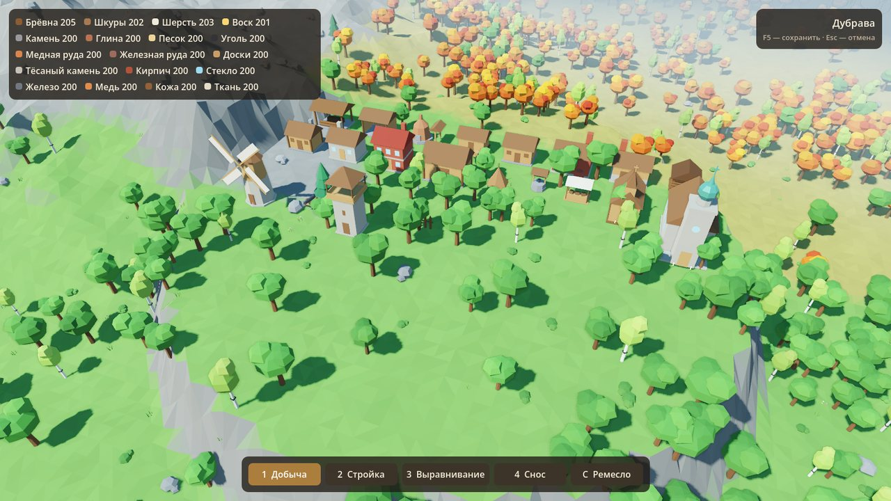
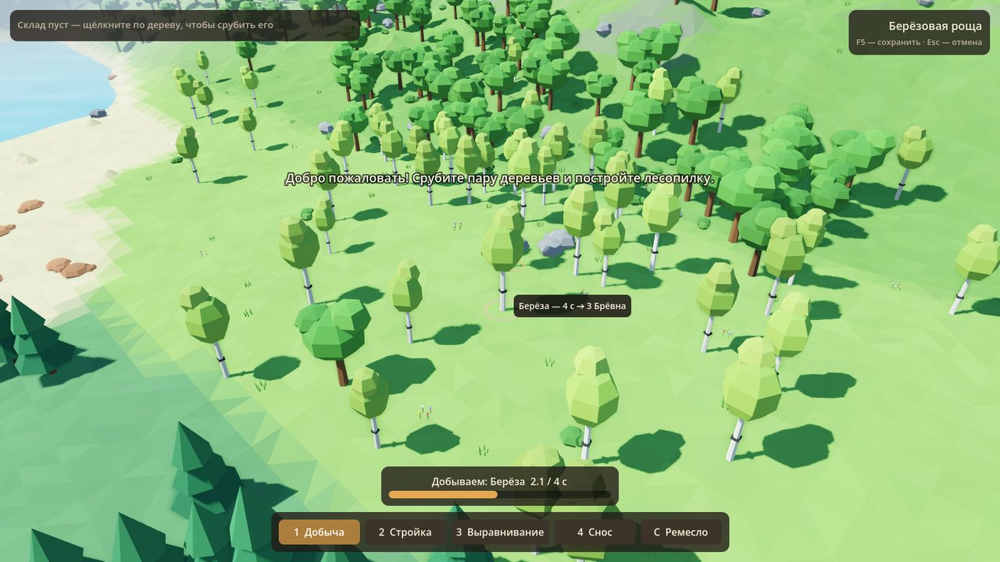
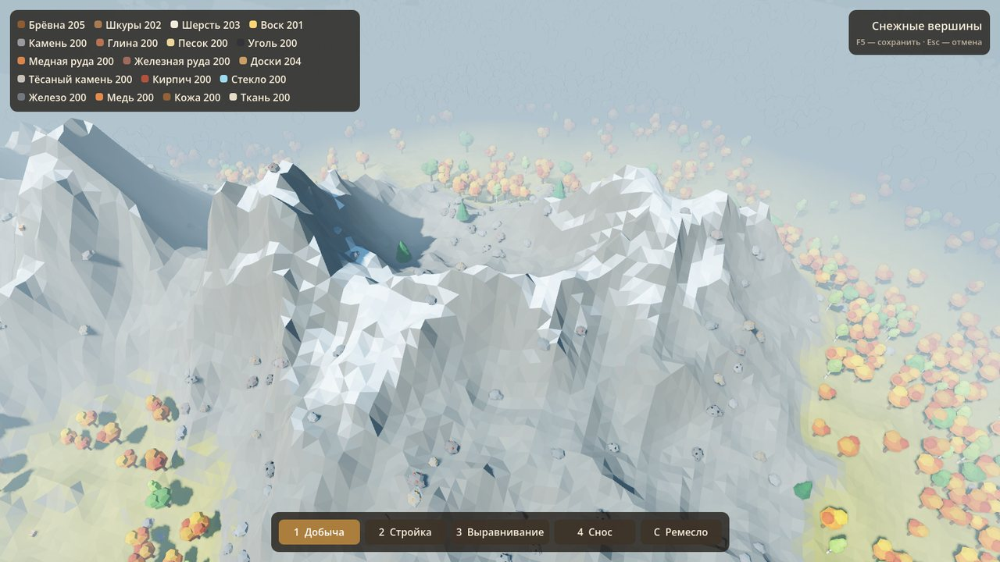
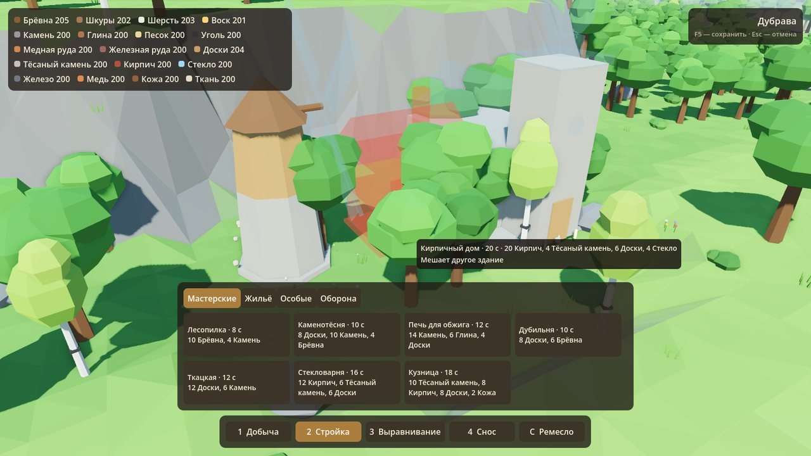

# Тихие Земли

Спокойный низкополигональный строительный симулятор на **Godot 4**.
Бесконечный мир с горами, равнинами и разными лесами, добыча ресурсов,
мастерские и старинные постройки: дома, мельницы, церкви, пушки.
Без людей, без животных, без рекламы.



| Лес и добыча | Горы | Меню стройки |
|---|---|---|
|  |  |  |

> Сейчас все модели — временные заглушки, собранные кодом из примитивов.
> Их нужно заменить моделями из Blender: список в [docs/MODELS.md](docs/MODELS.md).

## Запуск

1. Скачайте **Godot 4.7** (обычная версия, не .NET): <https://godotengine.org/download>.
2. В менеджере проектов нажмите **Import** и выберите `project.godot`.
3. Нажмите **F5**.

Мир сохраняется сам каждую минуту и при выходе, вручную — F5.
Чтобы начать новый мир, запустите игру с аргументом `-- --new-world`
или удалите `world.save` (меню Project → Open User Data Folder).

## Управление

| Действие | Клавиши |
|---|---|
| Двигать камеру | WASD / стрелки, Shift — быстрее, зажатое колесо — перетаскивание |
| Поворот и наклон камеры | Q / E или зажатая ПКМ |
| Приближение | колесо мыши |
| Добыча (деревья, камни, руды, сундуки) | **1**, затем ЛКМ по объекту; повторный щелчок убирает из очереди |
| Стройка | **2**, выбрать здание, ЛКМ — поставить, **R** — повернуть |
| Выравнивание земли | **3**, зажать ЛКМ; `[` `]` или Shift+колесо — размер кисти |
| Снос (возвращает половину ресурсов) | **4**, ЛКМ по зданию |
| Ремесло | **C** |
| Отмена | Esc или щелчок ПКМ |

WASD привязаны к физическим клавишам и работают на любой раскладке.

## Что уже работает

- **Бесконечный мир.** Мир состоит из чанков 32×32 м, которые генерируются по сиду в фоновых
  потоках (`WorkerThreadPool`) и выгружаются за пределами видимости. Края мира скрыты туманом.
- **11 биомов.** Равнины, дубрава, берёзовая роща, хвойный лес, осенний лес, пустыня, тундра,
  горы, снежные вершины, берег и озёра. Биом зависит от высоты, температуры и влажности.
- **Добыча с таймером.** Берёза рубится 4 с, дуб 7 с, железная жила 15 с и т. д.
  Действия встают в очередь до 6 штук. Деревья качаются и падают, камни рассыпаются.
- **Сундуки 5 редкостей.** Это единственный источник шкур, шерсти и воска. Чем дальше
  от старта, тем чаще попадаются редкие сундуки.
- **Ремесло.** 9 рецептов в 7 мастерских: доски, тёсаный камень, кирпич, стекло,
  железо, медь, кожа, ткань, древесный уголь.
- **21 здание.** Стройка длится от 2 до 30 с: детали появляются снизу вверх,
  у мельницы после постройки крутятся крылья.
- **Выравнивание рельефа.** Правки сохраняются и переживают выгрузку чанков.
- **Сохранение.** Хранится только то, что изменил игрок; сам мир каждый раз восстанавливается из сида.

## Ресурсы: из чего что строится

Главное правило: **здание выглядит ровно из того, из чего построено.** Каждая деталь
модели помечена материалом, материал привязан к ресурсу, а тест проверяет, что все
материалы модели есть в стоимости. Поэтому «деревянная» часовня целиком деревянная,
а каменной церкви нужны тёсаный камень, стекло для витражей и медь для купола.

```
Деревья ─────► Брёвна ──[Лесопилка]──► Доски
Валуны ──────► Камень ──[Каменотёсня]─► Тёсаный камень
Глина + Уголь ──────────[Печь]────────► Кирпич (и черепица)
Брёвна ─────────────────[Печь]────────► Древесный уголь
Песок + Уголь ──────────[Стекловарня]─► Стекло
Жилы + Уголь ───────────[Кузница]─────► Железо, Медь
Сундуки ─► Шкуры ───────[Дубильня]────► Кожа    (шатёр, меха кузницы)
Сундуки ─► Шерсть ──────[Ткацкая]─────► Ткань   (крылья мельницы, навес лавки)
Сундуки ─► Воск ──────────────────────► свечи часовни и церкви
```

Порядок развития: хижина → лесопилка → каменотёсня и печь → стекловарня →
дубильня и ткацкая (нужны сундуки) → кузница → мельница, церковь, пушки.

Все числа (время, стоимость, добыча, шансы в сундуках) лежат в одном файле:
[`scripts/autoload/game_data.gd`](scripts/autoload/game_data.gd).

## Структура проекта

```
project.godot
scenes/main.tscn                 главная сцена: свет, небо, вода, камера, системы
scripts/
  main.gd                        связывает системы, загрузка и сохранение
  autoload/
    game_data.gd                 ВСЕ данные: ресурсы, объекты, рецепты, здания, сундуки
    world_state.gd               изменения мира и сохранение
    inventory.gd                 склад
    crafting.gd                  очередь ремесла
    controls.gd                  клавиши по умолчанию
  world/
    world_gen.gd                 шумы, высоты, биомы, генерация чанка (в потоке)
    chunk_manager.gd             подгрузка и выгрузка чанков, луч мыши, выравнивание
    chunk.gd                     рельеф и объекты одного чанка (MultiMesh)
    prop_meshes.gd               модели-заглушки деревьев и камней ← заменить на .glb
    mesh_kit.gd                  сборщик low-poly мешей с плоским затенением
    chest.gd                     сундук
  building/
    blueprints.gd                модели-заглушки зданий (по деталям) ← заменить на .glb
    building.gd                  здание: анимация стройки, сноса, вращение крыльев
    building_system.gd           «призрак», проверки, размещение
  player/
    camera_rig.gd                плавная камера
    interaction.gd               инструменты и очередь добычи
  ui/hud.gd                      интерфейс
  fx/fx.gd                       всплывающий текст, частицы
shaders/water.gdshader           гранёная вода
tests/validate_data.gd           проверка баланса и правил
docs/                            план, стек, список моделей
```

## Проверка данных

После любых правок в `game_data.gd` или `blueprints.gd` запустите:

```
godot --headless --path . --script res://tests/validate_data.gd
```

Тест проверяет, что:
- ни одно действие не длится дольше 30 секунд;
- на модели здания нет материалов, которых нет в его стоимости;
- животные ресурсы выпадают только из сундуков;
- у каждого ресурса есть источник;
- каждое здание можно построить по цепочке ресурсов.

## Как добавить…

- **Ресурс:** строка в `RESOURCES`. Затем добавьте источник: объект в `PROPS`,
  рецепт в `RECIPES` или строку добычи в `CHESTS`.
- **Здание:** запись в `BUILDINGS` (стоимость и время) и чертёж в `Blueprints.parts()`.
  Запустите тест: он сразу покажет, если модель не совпадает со стоимостью.
- **Биом:** значение в `WorldGen.Biome`, запись в `WorldGen.BIOMES` и условие в `biome_at()`.

Дальнейший план и выбор инструментов — в [docs/ROADMAP.md](docs/ROADMAP.md).
